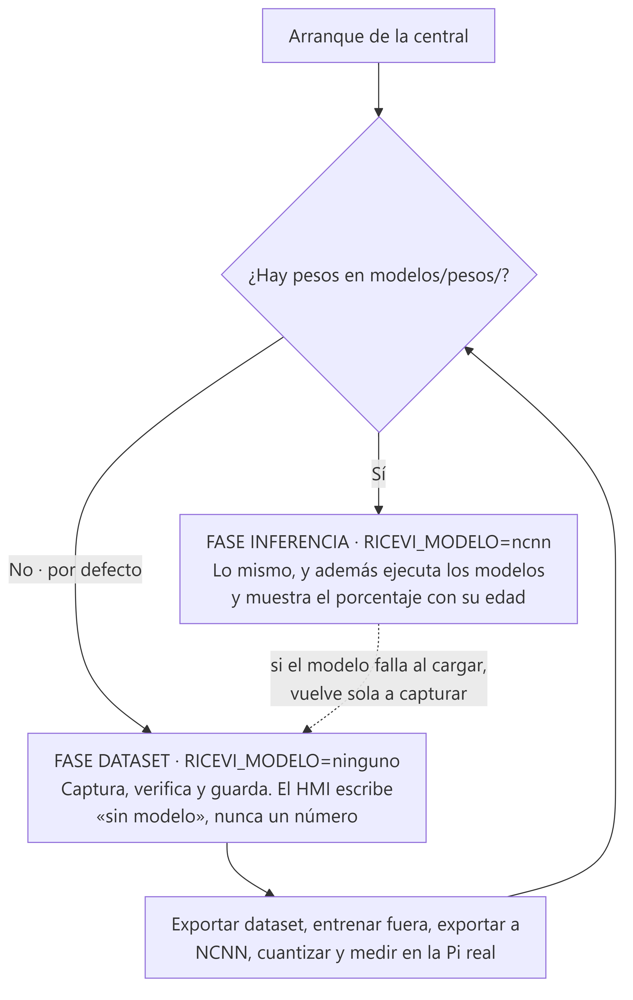
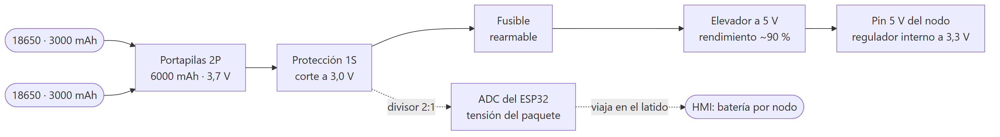
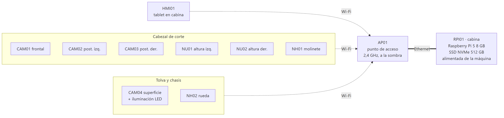
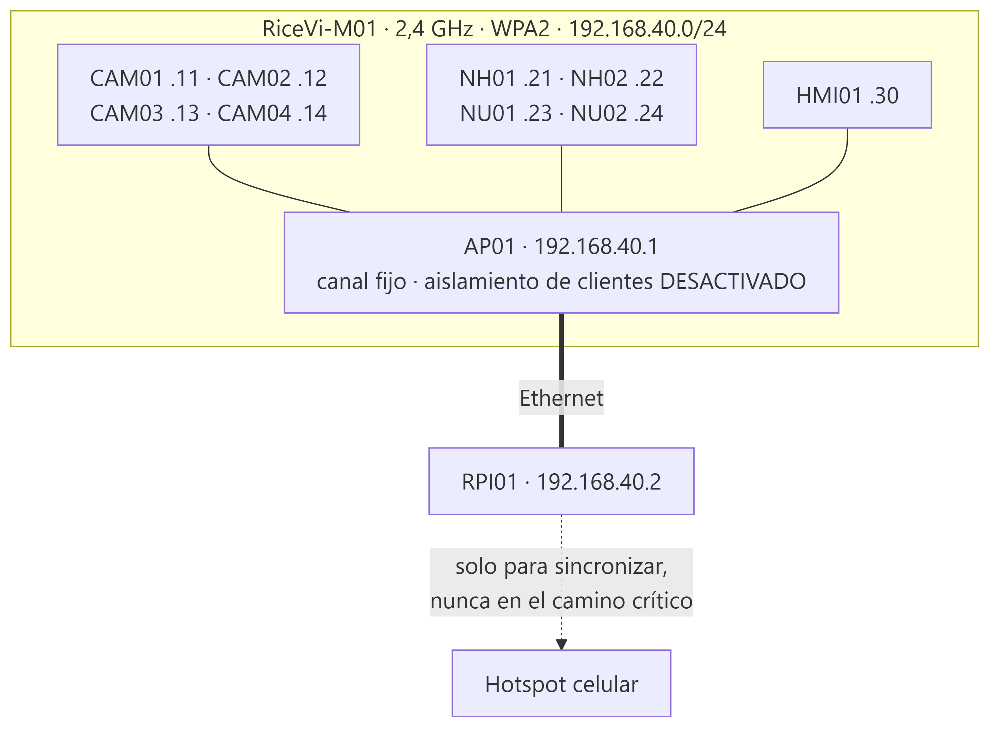
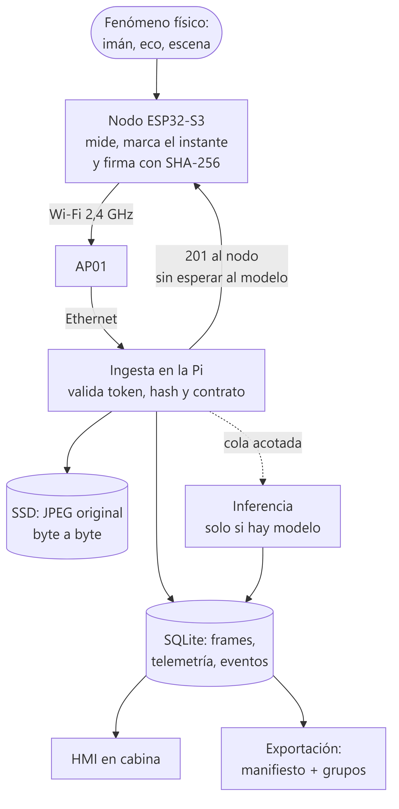
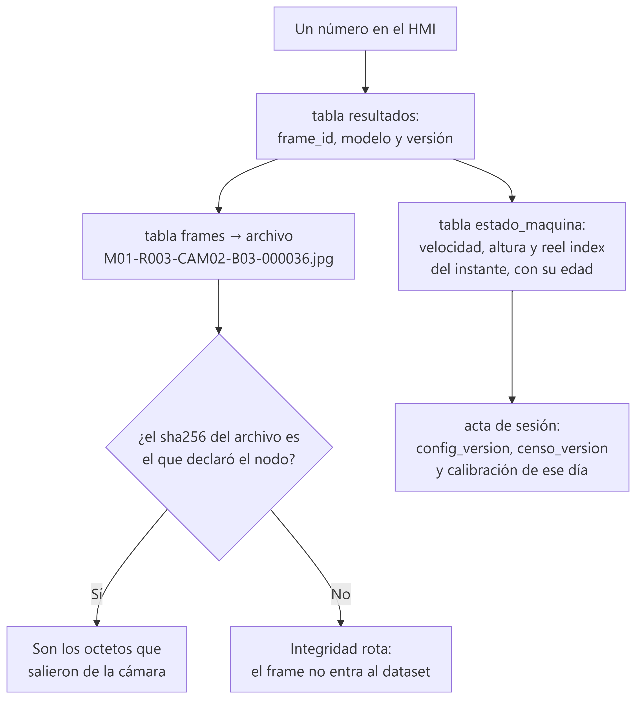

# Arquitectura y configuración del sistema RiceVi

**Documento de diseño · hardware, red y flujo de datos**
Versión 1.0 — 21 de septiembre de 2026

Este documento describe el sistema completo tal como va montado en la
cosechadora: qué hardware lo compone, cómo se alimenta, cómo se comunica, cómo
se identifican y guardan los datos y cómo se procesan. Corresponde al proyecto
`config-ricevi-campo/`, que es el código que se ejecuta.

Los valores marcados como **estimados** son cálculos de dimensionamiento que
todavía no se han medido sobre el montaje real. Están señalados uno a uno, y
cada uno indica cómo comprobarlo.

---

## 1 · Qué hace el sistema y en qué dos fases

RiceVi observa la operación de corte de una cosechadora de arroz con cuatro
cámaras y cuatro sensores, guarda esa observación de forma trazable, y —cuando
existan modelos entrenados— la analiza a bordo para dar retroalimentación al
operario.

El alcance es **percepción, diagnóstico y sugerencia**. El operario decide si
modifica la máquina; el sistema no acciona nada.

| Subsistema | Qué observa | Qué produce |
|---|---|---|
| PRE-CORTE | Cultivo antes de entrar al cabezal | Clase de acame: erecto, moderado, severo |
| POST-CORTE | Franja recién cortada | Fracción visual de material útil residual |
| TOLVA | Superficie del material acumulado | Fracción visual de material no grano |
| Operación | Molinete, rueda y distancia al suelo | RPM, velocidad estimada, alturas, *reel index* |

### 1.1 Las dos fases del mismo sistema



| Fase | Qué hace | Cómo se activa |
|---|---|---|
| **1 · Dataset** | Captura, verifica y almacena. **No infiere** | `RICEVI_MODELO=ninguno` *(por defecto)* |
| **2 · Inferencia** | Lo mismo, y además ejecuta los modelos | `RICEVI_MODELO=ncnn` con los pesos instalados |

**La fase 1 es la primera y dura toda la campaña de captura.** No hacen falta
modelos para salir a campo: hacen falta datos para poder entrenarlos.

> **Regla de diseño que gobierna todo el sistema:** cuando no hay modelo, la
> pantalla **no muestra un número**. Muestra «sin modelo».

No es un detalle de interfaz. Un sustituto que devuelve un porcentaje plausible
—por ejemplo, el ratio de píxeles verdes de la imagen— **no falla**: produce un
valor con la forma correcta, en el rango correcto, junto a la etiqueta «material
útil residual», y acaba en una tabla de la tesis sin que nadie lo detecte. Por
eso el motor por defecto devuelve nulo, y el nulo se distingue del cero en todo
el recorrido: en el contrato, en la base de datos y en la pantalla.

---

## 2 · Inventario de hardware

### 2.1 Los nueve equipos

| ID | Equipo | Ubicación | Función |
|---|---|---|---|
| `RPI01` | Raspberry Pi 5, 8 GB + SSD NVMe 512 GB | Cabina | Recibe, verifica, almacena, infiere y sirve el HMI |
| `CAM01` | ESP32-S3-CAM con OV3660 | Frente al cabezal | Cultivo antes del corte |
| `CAM02` | ESP32-S3-CAM con OV3660 | Detrás del cabezal, izquierda | Resultado del corte |
| `CAM03` | ESP32-S3-CAM con OV3660 | Detrás del cabezal, derecha | Resultado del corte |
| `CAM04` | ESP32-S3-CAM con OV3660 | Interior de la tolva | Superficie del material acumulado |
| `NH01` | ESP32-S3 + sensor Hall | Eje del molinete | Pulsos → RPM |
| `NH02` | ESP32-S3 + sensor Hall | Rueda instrumentada | Pulsos → velocidad estimada |
| `NU01` | ESP32-S3 + A02YYUW | Extremo izquierdo del cabezal | Distancia → altura de cuchilla |
| `NU02` | ESP32-S3 + A02YYUW | Extremo derecho del cabezal | Distancia → altura de cuchilla |

Más dos equipos de apoyo: `AP01`, el punto de acceso Wi-Fi de 2,4 GHz, y
`HMI01`, una tablet o teléfono con un navegador.

**Ocho microcontroladores, uno por punto de captura.** Cada sensor y cada cámara
tiene su propio ESP32-S3 junto a él.

### 2.2 Por qué un microcontrolador por sensor

| Ventaja | Explicación |
|---|---|
| Cables cortos | Cada sensor queda a centímetros de su microcontrolador. Desaparecen las tiradas largas de UART y de pulsos por el chasis |
| Aislamiento de fallas | Un nodo caído se lleva un solo sensor, no todas las variables operativas |
| Montaje independiente | Cada caja se ubica donde conviene mecánicamente |
| Firmware simple | Cada nodo hace una cosa. El conteo de pulsos no comparte CPU con la UART del ultrasónico |

El coste es que hay nueve estaciones Wi-Fi compartiendo un canal, nueve relojes
que sincronizar y nueve paquetes de batería que vigilar. Las tres cosas están
resueltas y se explican en las secciones 4, 6 y 3.

### 2.3 La central

| Elemento | Elección | Por qué |
|---|---|---|
| Computador | Raspberry Pi 5, 8 GB | Cuatro núcleos Cortex-A76 a 2,4 GHz. La RAM no es el recurso escaso; la CPU sí |
| Almacenamiento | SSD NVMe 512 GB por PCIe | A 1 imagen/s por cámara son ~17 GB por jornada: una microSD ni tiene capacidad ni aguanta esa escritura a diario |
| Sistema de archivos | ext4 con *journaling* | Recuperación fiable ante un corte, a diferencia de FAT |
| Reloj | RTC con batería | Da hora civil fiable sin Internet. Sin él, los datos quedan marcados `utc_quality: desconocida` |
| Refrigeración | Disipador con ventilador activo | Bajo carga sostenida el SoC se estrangula a partir de 80 °C |
| Acelerador de IA | **Ninguno** | Decisión del proyecto. La sección 8.3 documenta qué haría falta si luego se añade |

**Por qué 512 GB.** A 1 imagen/s por cámara, una jornada de ocho horas son
115.200 fotografías y unos 17 GB. Con 512 GB caben unas tres jornadas, que es el
margen para no tener que descargar cada noche sin falta.

---

## 3 · Alimentación

Dos sistemas independientes, y es deliberado: **la central va alimentada de la
máquina y cada nodo lleva su propia batería**. Así, un fallo en la instalación
eléctrica de la cosechadora no apaga los ocho nodos a la vez, y montar un nodo
no exige tirar cable hasta él.

### 3.1 Los nodos: paquete de dos celdas 18650



| Elemento | Especificación |
|---|---|
| Celdas | 2 × 18650 de 3000 mAh, **en paralelo** (2P1S) |
| Capacidad del paquete | 6000 mAh a 3,7 V nominales ≈ 22,2 Wh |
| Energía útil estimada | ≈ 18,9 Wh (85 % aprovechable hasta el corte) |
| Protección | Placa 1S con corte por descarga profunda a 3,0 V |
| Conversión | Elevador a 5 V, rendimiento ≈ 90 %, al pin de 5 V del nodo |
| Medida de tensión | Divisor 2:1 al ADC del ESP32 |
| Carga | **Fuera de la máquina.** Dos juegos de paquetes: uno montado, otro cargando |

**Por qué en paralelo y no en serie.** En paralelo el paquete sigue siendo 1S:
la protección y la carga son las de una sola celda, y la medida de tensión es
directa. En serie harían falta balanceo y un BMS de 2S para ganar una eficiencia
que el convertidor ya proporciona.

**Por qué dos celdas y no una.** Con una sola celda, un nodo de cámara da unas
8,5 horas estimadas. Una jornada de cosecha puede pasar de diez, y ese margen se
lo comen el envejecimiento de la celda, el calor y los reintentos de enlace.

### 3.2 Autonomía estimada

Las cuentas están a la vista para que puedan rehacerse con medidas propias, en
lugar de creerse un número:

| Rol | Consumo a 3,3 V | Ahorro Wi-Fi | Potencia en batería | **Autonomía estimada** |
|---|---:|---|---:|---:|
| Cámara | 200 mA | No | 1,11 W | **≈ 17 h** |
| Nodo Hall | 140 mA → 77 mA | **Sí** | 0,43 W | **≈ 44 h** |
| Nodo ultrasónico | 145 mA → 79 mA | **Sí** | 0,44 W | **≈ 43 h** |

> **Son estimaciones, no medidas.** Hay que confirmarlas con un multímetro en
> serie sobre un nodo real antes de dar la autonomía por buena. El script
> `config/censo.py` imprime el desglose completo del cálculo.

### 3.3 El ahorro de energía del radio: una decisión que no es uniforme

Desactivar el ahorro de energía del Wi-Fi mantiene el radio en recepción
continua. Eso reduce la latencia —el nodo responde de inmediato en vez de
esperar a la siguiente baliza— y **aproximadamente duplica el consumo**.

La decisión correcta es distinta para cada tipo de nodo, y sale de los números:

| Nodo | Ahorro | Razón |
|---|---|---|
| **Cámaras** | **Desactivado** | El enlace es el cuello de botella de la latencia. Dormir el radio añade decenas de milisegundos impredecibles justo donde duele |
| **Sensores** | **Activado** | Su telemetría viaja por lotes de ~1 s y **cada muestra lleva su propio instante de captura**: el retraso de entrega no degrada la medida. Sale casi gratis y casi duplica la autonomía |

Esa asimetría es un buen ejemplo de cómo el contrato de datos paga dividendos:
como el instante de la medida viaja *dentro* de la muestra y no se deduce de
cuándo llegó, retrasar la entrega no cuesta precisión.

El ajuste **no está compilado en el firmware**: llega en el plan que la central
envía a cada nodo, de modo que cambiarlo es editar un archivo y reiniciar la
central.

### 3.4 Seguridad y temperatura de las celdas

Esto merece una advertencia explícita, porque combina mal con el resto del
montaje:

> **Las celdas de Li-ion no deben ir en una caja sellada y oscura expuesta al
> sol.** Una caja así en un arrozal colombiano pasa con facilidad de 60 °C
> internos, y por encima de esa temperatura una celda de Li-ion se degrada
> rápido y deja de ser segura.

Medidas concretas:

| Medida | Detalle |
|---|---|
| Ubicación | A la sombra siempre que sea posible; nunca en el punto más soleado |
| Caja | Color claro, y ventilada donde el ambiente lo permita |
| Carga | **Nunca dentro de la máquina.** Cargar Li-ion por encima de 45 °C no es seguro |
| Celdas | Protegidas, o con placa de protección 1S. La descarga profunda arruina la celda |
| Montaje | Portapilas, **no soldar directamente a la celda** sin soldadura por puntos |
| Fusible | Rearmable, en serie con el paquete |
| Inspección | Revisar las celdas al cambiarlas: hinchazón, corrosión o calor anómalo |

### 3.5 La central

| Elemento | Especificación |
|---|---|
| Fuente | Convertidor DC-DC 12 V → 5 V, **6 A mínimo**, de calidad |
| Consumo típico | ≈ 9–12 W al 70 % de CPU con NVMe y Ethernet *(estimado)* |
| Reserva local | 1000 µF electrolíticos más cerámicos junto a la Pi |
| Protección | Fusible propio, independiente del resto |
| Apagado | Señal de contacto de la máquina a un GPIO, por optoacoplador |

**Por qué 6 A para algo que consume 12 W.** Raspberry Pi recomienda 5 V / 5 A
para la Pi 5, no porque consuma 25 W de forma continua, sino porque el sistema
de gestión de energía necesita margen para los picos y **reacciona mal a la
caída de tensión**. Un convertidor genérico de 3 A con cable fino produce
reinicios por subtensión, que es el fallo más común y más difícil de
diagnosticar en despliegues de este tipo.

**El apagado ordenado es el fallo nuevo que introduce usar una Pi.** Un ESP32 se
desconecta en caliente casi impunemente; una Raspberry Pi no. Al girar la llave,
la señal de contacto dispara el cierre de la base, la consolidación del disco y
el apagado limpio.

---

## 4 · Montaje físico y red

### 4.1 Dónde va cada cosa



La decisión de montaje resuelve una tensión: **la Pi quiere estar fresca y la
antena quiere estar cerca de los nodos.** Se separan.

> **`RPI01` en cabina, `AP01` fuera y cerca del cabezal, unidos por Ethernet
> apantallado.**

El punto de acceso es pequeño, barato de reemplazar y tolera la intemperie
mucho mejor que una Pi con SSD. La Pi vive en el sitio benigno, y el enlace
entre ambos es cable, no radio.

| Elemento | Requisitos de montaje |
|---|---|
| Caja de `RPI01` | Rejillas con filtro de polvo, ventilador, montaje antivibración, acceso a conectores |
| Caja de `AP01` | Estanca, antena orientada hacia los nodos, lo más alta posible, lejos de masas metálicas |
| Cajas de cámara | Visor transparente limpiable, **sujeción mecánica del conector FPC**, orientación fijada y documentada |
| Cajas de sensor | Estancas, con prensaestopas y alivio de tensión |
| Todas | Color claro, a la sombra cuando se pueda (ver 3.4), **etiquetadas antes de montar** |

### 4.2 La red



| Parámetro | Valor | Por qué |
|---|---|---|
| SSID | `RiceVi-M01` | Uno por máquina |
| Seguridad | WPA2-PSK | WPA3 puro puede no negociar con el ESP32 |
| **Banda** | **Solo 2,4 GHz** | El ESP32-S3 **no tiene radio de 5 GHz**. En «automático» el nodo no ve la red, y el síntoma es idéntico al de una placa averiada |
| **Canal** | **Fijo: 1, 6 u 11** | Un canal automático puede cambiar en marcha y desconectar a los ocho a la vez |
| Ancho | 20 MHz | 40 MHz en 2,4 GHz añade interferencia sin beneficio |
| **Aislamiento de clientes** | **DESACTIVADO** | Si está activo, los nodos ven Internet pero **no ven a la Pi**. Es el fallo número uno y no da ningún mensaje de error |
| DHCP | Con reservas por MAC | Direcciones fijas sin grabar nada en el nodo |
| Portal cautivo | Ninguno | Un ESP32 no puede aceptar términos en una página |

### 4.3 Router o celular: el número que decide

| Elemento | Estaciones Wi-Fi |
|---|---|
| Cuatro cámaras | 4 |
| Cuatro nodos de sensor | 4 |
| `HMI01` | 1 |
| `RPI01`, solo si no va por cable | 1 |
| **Total** | **9 o 10** |

| Punto de acceso | Clientes que admite | ¿Sirve? |
|---|---|---|
| Router o AP dedicado | Decenas | **Sí, con holgura** |
| Hotspot de Android | Hasta unos 10, según fabricante | Justo, sin margen |
| Hotspot de iPhone | Unos 5, según modelo y operador | **No. No caben ocho nodos** |

**Conclusión: router dedicado para campo.** El hotspot de un teléfono sirve para
pruebas parciales con dos o tres nodos en el taller, y como plan de
contingencia, pero no para el sistema completo.

Si el router falla en campo, la Pi puede hacer de punto de acceso con su propia
radio. Los nodos la encuentran por la tercera vía de descubrimiento. El coste es
que la Pi pierde su salida a Internet mientras tanto, lo cual para capturar
dataset es irrelevante.

### 4.4 Cómo encuentra un nodo a la central

Tres vías, probadas en orden, con `GET /salud` como prueba de vida:

| Vía | Cuándo funciona |
|---|---|
| 1 · IP fija `192.168.40.2` | Red de campo con reservas DHCP |
| 2 · mDNS `ricevi-rasp-01` | Hotspot de móvil, o si la reserva falló |
| 3 · Puerta de enlace | Solo si la Pi es además el punto de acceso |

Se prueba `/salud` y no un socket a secas porque **que el puerto acepte una
conexión TCP no significa que la central esté lista**: el servidor escucha antes
de que el motor esté cargado.

### 4.5 Los cinco fallos de red, en orden de descarte

**La primera comprobación que falla dice dónde está el problema.**

| # | Comprueba | Si falla |
|---|---|---|
| 1 | El nodo se asocia al SSID | Banda equivocada, contraseña, o fuera de cobertura |
| 2 | Recibe IP por DHCP | Servidor agotado o reserva mal escrita |
| 3 | Alcanza `192.168.40.2` | **Aislamiento de clientes activado**, o la Pi caída |
| 4 | Recibe `200` de `/salud` | Cortafuegos, o servicio no arrancado |
| 5 | Sigue conectado **en movimiento** | Cobertura. Es el que no se detecta en el taller |

El quinto merece atención: un nodo en el extremo del cabezal, con el chasis
metálico entre su antena y la del AP, puede asociarse perfectamente parado y
perder el enlace cada vez que la máquina gira. La prueba es circular con el
sistema en marcha y mirar la tasa de reintentos por nodo, no la señal en reposo.

---

## 5 · Cómo se identifican los datos

Esta sección define el etiquetado. Si algo de aquí cambia después de empezar a
capturar, el dataset queda partido en dos mitades que no se pueden comparar.

### 5.1 Los identificadores

| Identificador | Forma | Quién lo asigna | Cuándo cambia |
|---|---|---|---|
| `machine_id` | `M01` | Fijo del proyecto | Si hay una segunda cosechadora |
| `session_id` | `R001`, `R002`… | La central al arrancar | Una por jornada |
| `node_id` | `CAM01`…`NU02` | El censo, grabado en NVS | **Nunca.** Es la identidad del equipo |
| `sensor_id` | `HALL01`, `US01`… | El censo | **Nunca.** Sigue al sensor aunque cambie de placa |
| `boot_id` | `B01`, `B02`… | El nodo | En cada arranque |
| `seq` | Entero continuo | El nodo | Se reinicia solo con `boot_id` nuevo |
| `frame_id` | `M01-R001-CAM02-B03-000036` | El nodo | Uno por imagen |
| `config_version` | `cfg-campo-1.0.0` | La central | Al cambiar un parámetro que afecta a los datos |
| `censo_version` | `censo-1.0.0` | El censo | Al cambiar una posición, una IP o una calibración |

### 5.2 Tres reglas del `frame_id`

```
^[A-Z0-9]{3}-R\d{3}-(CAM|NH|NU)\d{2}-B\d{2,4}-\d{6}$
```

1. **`seq` va con seis dígitos y ceros a la izquierda.** Así el orden alfabético
   de los nombres de archivo coincide con el orden temporal.
2. **`seq` no se reinicia dentro del mismo `boot_id`.** Es lo que permite
   detectar huecos: si llegan el 35 y el 37, se perdió el 36 y queda contado.
   Sin secuencia continua, una pérdida es invisible.
3. **Lo genera el nodo, no la central.** Es lo que hace posible el reintento
   idempotente: si la confirmación se pierde y el nodo reenvía, la central
   reconoce el mismo identificador y no crea un duplicado.

**Por qué `boot_id`.** Sin él, el frame 36 de hoy y el 36 de después de un
reinicio serían el mismo identificador, y uno pisaría al otro.

**Por qué `sensor_id` no es el `node_id`.** Si la placa `NU01` se avería y se
sustituye, el sensor montado sigue siendo `US01`. La calibración, el
`offset_b_mm` y el histórico pertenecen al sensor, no a la placa que lo lee.

### 5.3 Qué magnitud produce cada sensor

Cada nodo publica **lo que mide y lo que deriva, por separado**:

| Sensor | Magnitud | Unidad | ¿Derivada? | Fórmula |
|---|---|---|---|---|
| `HALL01` | `pulsos_ventana` | count | No | Conteo directo del contador por hardware |
| `HALL01` | `reel_rpm` | rpm | **Sí** | `60·N / (P·Δt)` |
| `HALL02` | `pulsos_ventana` | count | No | Conteo directo |
| `HALL02` | `wheel_speed` | m/s | **Sí** | `N·C / (P·Δt)` |
| `US01` `US02` | `distance` | mm | No | Trama del A02YYUW, validada |
| `US01` `US02` | `header_height` | mm | **Sí** | `distance − offset_b_mm` |

**Por qué se guarda también la cruda.** Si dentro de tres meses se corrige la
circunferencia efectiva de la rueda, con los pulsos guardados la velocidad de
toda la campaña se recalcula. Sin ellos, hay que repetir la campaña. Los pulsos
son el dato; las RPM son una interpretación del dato.

El *reel index* no lo calcula ningún nodo: `NH01` tiene las RPM y `NH02` la
velocidad, cada uno en una placa distinta. Lo calcula la central emparejando las
dos muestras más cercanas, y guarda **cuánto se separan en el tiempo**, porque
un índice calculado con muestras separadas dos segundos no es el mismo dato que
uno con veinte milisegundos.

### 5.4 Calidad: la regla del nulo

Cada muestra lleva dos campos que hacen cosas distintas:

- **`calidad`** decide si el dato se usa: `buena`, `dudosa`, `invalida`.
- **`codigo_calidad`** dice **por qué**, y es lo que permite diagnosticar.

| Código | Calidad | Significado |
|---|---|---|
| `ok` | buena | Lectura normal dentro de rango |
| `fuera_rango` | inválida | Fuera del rango físico declarado |
| `checksum` | inválida | La trama UART no superó la verificación |
| `timeout` | inválida | No llegó trama dentro del plazo |
| `sin_pulsos` | dudosa | Ventana sin pulsos: parada real o sensor caído |
| `eco_dudoso` | dudosa | Distancia plausible pero inestable |
| `sin_calibrar` | inválida | Falta la constante para derivar la magnitud |
| `saturado` | dudosa | Valor en el límite superior del rango |

**Por qué hacen falta los dos.** Una tasa de inválidas del 20 % con `calidad` a
secas no se puede diagnosticar. Con el código se sabe si es `checksum` —cableado,
ruido eléctrico, conector flojo— o `fuera_rango` —geometría de montaje,
vegetación, terreno—. Son dos averías distintas con dos soluciones distintas.

Y la regla que no se negocia:

> **Cuando no hay medida, el valor es nulo.** Nunca cero, nunca el último valor
> conocido, nunca un valor por defecto.

Un ultrasónico sin eco que devuelve `0` mete en el dataset una altura de
cuchilla de cero milímetros indistinguible de una medida real. Al entrenar, el
modelo aprende de ese cero. Es el tipo de contaminación que no se detecta
mirando gráficas y que invalida conclusiones meses después.

La regla se hace cumplir en el contrato: **una muestra con valor nulo y calidad
`buena` se rechaza**, porque es un error de firmware y no un estado del mundo.

---

## 6 · Cómo viajan y se guardan los datos



### 6.1 El protocolo

Todo va por HTTP sobre la red local, con un **token por nodo** en la cabecera.
Ocho endpoints:

| Endpoint | Emisor | Qué hace |
|---|---|---|
| `POST /v1/nodes/register` | Nodo | Se presenta y recibe sesión, plan y ranura de reloj |
| `POST /v1/time/exchange` | Nodo | Intercambio de cuatro tiempos |
| `GET /v1/nodes/{id}/plan` | Nodo | Ritmo, resolución, ROI y calibración |
| `POST /v1/upload-slots` | Cámara | Pide turno de subida |
| `POST /v1/frames` | Cámara | Imagen y metadatos, en una sola operación |
| `POST /v1/telemetry` | Sensor | Lote de muestras |
| `POST /v1/events` | Todos | Latido, batería, descarga de tolva, error |
| `GET /api/*` | HMI | Estado, resultados, trazabilidad |

**El nodo no decide casi nada.** El ritmo de captura, la resolución, el ROI, la
ranura de reloj, los umbrales de batería y el ahorro de radio llegan en el plan.
Cambiar el ritmo de una cámara es editar un archivo y reiniciar la central, no
desmontar una caja del cabezal. Ocho veces.

### 6.2 El turno de subida

Ocho nodos comparten un canal. Si las cuatro cámaras suben a la vez no van
cuatro veces más rápido: compiten, colisionan, retransmiten, y las cuatro tardan
más que si hubieran ido en fila. El control de admisión serializa las subidas.

Hay un segundo efecto, menos obvio: mientras las cámaras compiten, **la
telemetría también compite**. Los nodos de sensor no piden turno —su tráfico es
pequeño— pero si el aire está saturado por cuatro imágenes simultáneas, sus
lotes se retrasan. El turno protege también el dato que da contexto a las
imágenes.

Los turnos **caducan**: si un nodo pide turno y se cuelga o se queda sin
batería, sin caducidad bloquearía a los demás para siempre.

### 6.3 La regla central del sistema

> La central responde `201` en cuanto el archivo está en disco y su fila en la
> base. **Encola la inferencia después, sin esperarla nunca.**

Si la cámara esperara al resultado del modelo, un pico de carga de CPU se
propagaría hacia atrás hasta detener la captura. Un problema de diagnóstico se
habría convertido en pérdida de dataset.

**Cuando el sistema se satura se pierde diagnóstico, nunca dataset.** Y el
descarte queda contado, que es lo que convierte una degradación silenciosa en un
número medible.

### 6.4 Integridad

Cada imagen viaja con su SHA-256, calculado por el nodo. **La central lo
recalcula sobre los octetos recibidos**: el hash del nodo prueba lo que el nodo
cree haber enviado; recalcularlo prueba que el viaje no los alteró.

El archivo se escribe a un nombre temporal, se fuerza a disco y se renombra. El
renombrado dentro del mismo sistema de archivos es atómico, así que **nunca
existe un `.jpg` a medio escribir**: si la Pi se apaga en mitad, queda un
temporal que se barre, no un JPEG truncado que parece válido.

Lo que el hash **no** garantiza, y conviene decirlo: que la escena sea útil, que
esté enfocada o que la lente no estuviera sucia. Es integridad de octetos, no
calidad de imagen.

### 6.5 Los tres casos de un identificador repetido

Un nodo que no recibe la confirmación reenviará el mismo frame. Es lo correcto
por su parte: no puede saber si llegó.

| Situación | Respuesta | Por qué |
|---|---|---|
| Mismo ID, mismo hash | `200` con el estado existente | Reenvío legítimo. No duplica |
| Mismo ID, hash distinto | `409` | Dos contenidos reclaman la misma identidad: es un fallo de firmware y hay que verlo |
| ID nuevo | `201` | Camino normal |

### 6.6 Qué se guarda y dónde

```
/datos/ricevi/
├── ricevi.db                     SQLite en modo WAL
├── frames/R001/CAM02/*.jpg       los octetos originales, sin recomprimir
├── derivados/                    máscaras y superposiciones, borrables
└── export/                       CSV para análisis
```

| Tabla | Contenido |
|---|---|
| `sesiones` | El **acta**: instantánea completa de la configuración con la que se capturó |
| `nodos` | Los ocho, con batería, RSSI y última vez vistos |
| `frames` | Una fila por imagen, con ruta, hash y tiempos |
| `telemetria` | Una fila por magnitud, con crudos y código de calidad |
| `estado_maquina` | Estado operativo fusionado, con la edad de cada campo |
| `resultados` | Una fila por inferencia, con modelo, versión y tiempos por etapa |
| `eventos` | Arranques, cortes, batería baja, cambios de estado térmico |
| `intercambios_tiempo` | Todos los intercambios de reloj, para medir la deriva |

**Los `.jpg` son los octetos recibidos, byte a byte. Nunca se recomprimen.**
Cualquier versión anotada va a `derivados/`, que se puede borrar sin tocar el
dataset.

`estado_maquina` es **derivada**: se puede borrar y regenerar entera desde
`telemetria`. Eso significa que un error en esa lógica no destruye nada.

### 6.7 Sincronía de relojes

Cada nodo tiene un reloj que deriva, y la red añade retraso variable. Coincidir
en la hora de recepción no basta.

El intercambio de cuatro tiempos estima el desfase:

```
offset ≈ [(t₂ − t₁) + (t₃ − t₄)] / 2        RTT = (t₄ − t₁) − (t₃ − t₂)
```

El término `(t₃ − t₂)` resta lo que la central tardó en procesar, de modo que el
RTT mide solo el viaje. Importa: con la CPU cargada de inferencia, sin ese
término se confundiría carga de CPU con mala red.

Se repite siete veces y **se conserva el de menor RTT**: es el que menos
encolado ha sufrido, y por tanto aquel en el que el supuesto de simetría
ida/vuelta es menos falso.

**El supuesto hay que declararlo en la tesis:** la fórmula asume que ida y
vuelta tardan lo mismo. En Wi-Fi eso es falso en general. Por eso cada registro
lleva `sync_uncertainty_ms` y el desfase no se presenta como exacto.

Los ocho nodos sincronizan **escalonados**, cada uno en su ranura de un ciclo de
30 segundos, para no producir una ráfaga periódica que compita con las imágenes.
La ranura es fija por nodo: si se asignara por orden de llegada, un nodo que se
reinicia caería en la ranura de otro.

---

## 7 · Cómo se procesa

### 7.1 En fase de dataset

No se procesa: se guarda. La tubería se ejercita igual —el frame entra en la
cola, se mide el tiempo de espera, se registra el resultado— y lo único que no
hay es un número inventado.

Eso produce, además, la **línea de base de latencia** contra la que se comparará
el coste real del modelo cuando llegue.

### 7.2 En fase de inferencia

| Tarea | Tipo de problema | Cámara | Ritmo |
|---|---|---|---|
| Acame | Clasificación ordinal, 3 clases | `CAM01` | 1 de cada 2 frames |
| Post-corte | Segmentación semántica | `CAM02` `CAM03` | 1 de cada 1 |
| Tolva | Segmentación semántica | `CAM04` | 1 de cada 3 |

**Captura e inferencia son dos ritmos distintos.** El dataset se queda con todas
las imágenes; solo el diagnóstico se ralentiza. Una imagen que hoy no se infiere
no se pierde: está en el disco y puede procesarse en diferido.

**Segmentación semántica y no de instancias.** Para obtener un porcentaje de
píxeles, lo natural es la semántica. Un modelo de instancias produce objetos
individuales que luego habría que unir para no contar píxeles dos veces, y paga
un coste por información que el indicador no usa.

**NCNN y no PyTorch.** Medido sobre Raspberry Pi 5 con YOLO11n a 640 × 640:
NCNN 93,9 ms, ONNX 181,8 ms, TensorFlow Lite 324,2 ms, PyTorch 524,8 ms. Más de
cinco veces de diferencia, sin coste.

### 7.3 El presupuesto de CPU, y el lazo térmico

Sin acelerador, la inferencia consume una fracción grande de la CPU. Eso genera
calor, y el calor genera un lazo que no se estabiliza solo:

```
CPU al 70 % → sube la temperatura → el SoC se estrangula a 80 °C
→ cada inferencia tarda más → la cola crece → CPU al 100 % → más calor
```

La respuesta es **degradar deliberadamente antes de que lo haga el hardware**:

| Temperatura del núcleo | Acción |
|---|---|
| < 65 °C | Ritmos normales |
| 65 – 72 °C | La tolva baja a la mitad |
| 72 – 78 °C | Todas las cámaras a la mitad |
| 78 – 82 °C | Solo post-corte, a un cuarto |
| > 82 °C | **Inferencia en pausa** |

> **La captura nunca se degrada por temperatura.** Solo el diagnóstico.

Cada cambio de escalón se registra como evento, para que un análisis posterior
pueda explicar por qué una jornada tiene huecos de diagnóstico.

---

## 8 · Trazabilidad



La pregunta que el sistema tiene que poder responder meses después es:

> *«El HMI mostró 12,86 % a las 13:42. ¿De qué imagen salió, con qué modelo, en
> qué condiciones de máquina, y son esos los octetos originales?»*

| Paso | Dónde se mira |
|---|---|
| 1 | `resultados` → `frame_id`, modelo, versión, tiempos por etapa |
| 2 | `frames` → ruta, `sha256`, instante de captura |
| 3 | El archivo en disco → los octetos |
| 4 | Recalcular el hash → confirma que nadie los tocó |
| 5 | `estado_maquina` → contexto operativo, con la edad de cada campo |
| 6 | `sesiones` → el acta: `config_version`, `censo_version` y calibración de ese día |

**Si el paso 4 falla, el frame no entra al dataset.** No se arregla ni se acepta
con una nota: se marca y se excluye. Un archivo cuyos octetos no coinciden con
lo que declaró el nodo no se sabe qué es.

El acta de sesión importa más de lo que parece: si una jornada se capturó con
una calibración provisional o con una MAC sin registrar, el acta lo dice. Sin
ella, dos tandas con el mismo `config_version` pero distinto montaje parecerían
comparables y no lo son.

---

## 9 · Lista de materiales

Precios de referencia en dólares, **estimaciones para dimensionar**, sin
aranceles ni IVA.

### 9.1 La central

| Cant. | Ítem | Ref. |
|---:|---|---:|
| 1 | Raspberry Pi 5, 8 GB | US$ 80 |
| 1 | Disipador con ventilador activo | US$ 5 |
| 1 | M.2 HAT+ para NVMe | US$ 15 |
| 1 | SSD NVMe 512 GB | US$ 45 |
| 1 | Batería de RTC | US$ 5 |
| 1 | microSD de emergencia con el sistema | US$ 8 |
| 1 | Caja ventilada con filtro y antivibración | US$ 25 |
| | **Subtotal** | **US$ 183** |

### 9.2 Nodos, sensores y baterías

| Cant. | Ítem | Ref. |
|---:|---|---:|
| 2 paq. | 3 × ESP32-S3-CAM con OV3660 | US$ 70 |
| 2 paq. | 3 × ESP32-S3 N16R8 | US$ 38 |
| — | Envío a Colombia | US$ 20 |
| 2 | Ultrasónico A02YYUW | US$ 48 |
| 2 | Sensor Hall + imanes | US$ 22 |
| **32** | **Celda 18650 3000 mAh protegida** | **US$ 160** |
| **16** | **Portapilas 2×18650 + protección 1S** | **US$ 48** |
| **8** | **Elevador a 5 V** | **US$ 24** |
| 1 | Cargador de bahía para 18650 | US$ 25 |
| 5 | microSD 32 GB | US$ 40 |
| 8 | Caja IP65 con prensaestopas | US$ 56 |
| 1 | Iluminación LED de tolva + referencia de color | US$ 20 |
| — | Cable, conectores y herrajes | US$ 60 |
| | **Subtotal** | **US$ 631** |

**32 celdas y no 16**: dos juegos completos de paquetes, uno montado y otro
cargando. Es lo que permite trabajar dos jornadas seguidas sin esperar cargas.

### 9.3 Red y energía

| Cant. | Ítem | Ref. |
|---:|---|---:|
| 1 | Punto de acceso 2,4 GHz | US$ 35 |
| 1 | Caja estanca para el AP | US$ 15 |
| 1 | Cable Ethernet apantallado | US$ 12 |
| 1 | DC-DC 12 V → 5 V, 6 A, para la Pi | US$ 18 |
| 1 | Optoacoplador y componentes de contacto | US$ 5 |
| 1 | Capacitancia, fusibles y protección | US$ 30 |
| | **Subtotal** | **US$ 115** |

| | **Total estimado de hardware** | **≈ US$ 930** |
|---|---|---:|

Sin servicio de nube recurrente: la inferencia es local.

---

## 10 · Lo que falta medir antes de publicar

Cuatro constantes se miden con un metro, no con código. **El sistema captura
dataset válido sin ellas**, porque guarda siempre la magnitud cruda, pero hasta
que estén medidas y anotadas, `reel_rpm`, `wheel_speed`, `header_height` y
`reel_index` **no se pueden publicar**.

| Constante | Cómo se mide |
|---|---|
| `circunferencia_rueda_m` | Marcar el neumático, avanzar **diez vueltas en campo y con carga**, medir y dividir |
| `radio_molinete_m` | Del centro del eje a la **punta de la púa**, máquina parada y bloqueada |
| `offset_b_mm` de `US01` | De la cara del sensor al plano de la cuchilla |
| `offset_b_mm` de `US02` | Igual, lado derecho. **No asumir que es el mismo número** |

Y tres medidas de ingeniería que el documento da por estimadas:

| Medida | Cómo se comprueba |
|---|---|
| Consumo real de cada tipo de nodo | Multímetro en serie, durante una hora de operación real |
| Autonomía real del paquete | Una jornada completa registrando la tensión del latido |
| Temperatura de la Pi bajo carga | Ocho horas al 70 % de CPU en la caja definitiva |

**Hasta que esas tres estén medidas, la autonomía de 17 horas de la sección 3.2
es un cálculo, no un hecho.**

---

## 11 · Resumen de decisiones y su porqué

| Decisión | Por qué |
|---|---|
| Un ESP32-S3 por sensor y por cámara | Cables cortos, fallos aislados, firmware simple |
| Batería propia por nodo | Un fallo eléctrico de la máquina no apaga los ocho |
| Dos celdas 18650 en paralelo | Una sola no da margen para una jornada larga |
| Ahorro de radio solo en sensores | Las cámaras pagan latencia; los sensores no, porque el instante viaja en la muestra |
| Central en cabina, AP fuera | La Pi quiere estar fresca, la antena cerca de los nodos |
| Router dedicado y no celular | Un hotspot de iPhone no admite nueve estaciones |
| SSD NVMe y no microSD | 17 GB por jornada, escritos a diario |
| Sin acelerador de IA | Decisión de proyecto; la CPU basta con ritmos escalonados |
| Segmentación semántica | Es lo que corresponde a un porcentaje de píxeles |
| NCNN | Cinco veces más rápido que PyTorch en esta máquina |
| Fase de dataset por defecto | Un sistema que arranca inventando números es peor que uno que calla |
| Valor nulo cuando no hay medida | Un cero inventado contamina el entrenamiento sin dejar rastro |
| `201` antes de inferir | La captura tiene prioridad sobre el diagnóstico |
| Hash recalculado en la central | Prueba el viaje, no solo lo que el nodo cree haber enviado |
| Degradación térmica deliberada | Elegir qué se pierde en vez de que lo elija el hardware |
